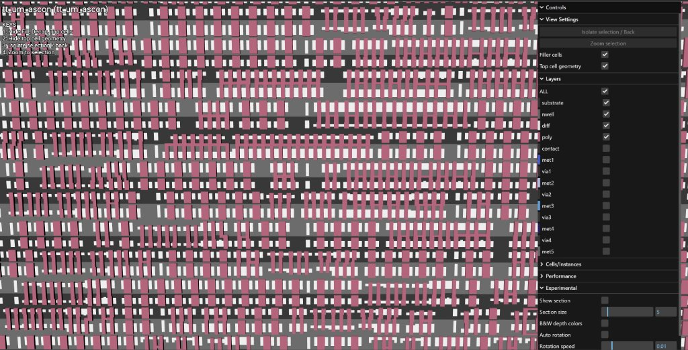
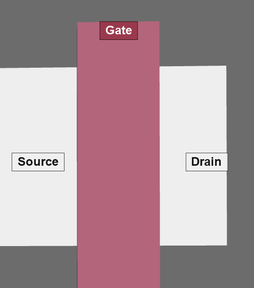
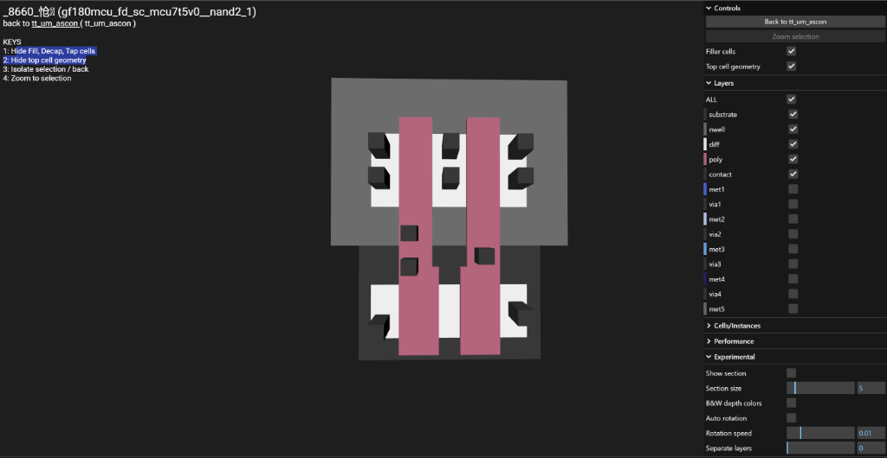
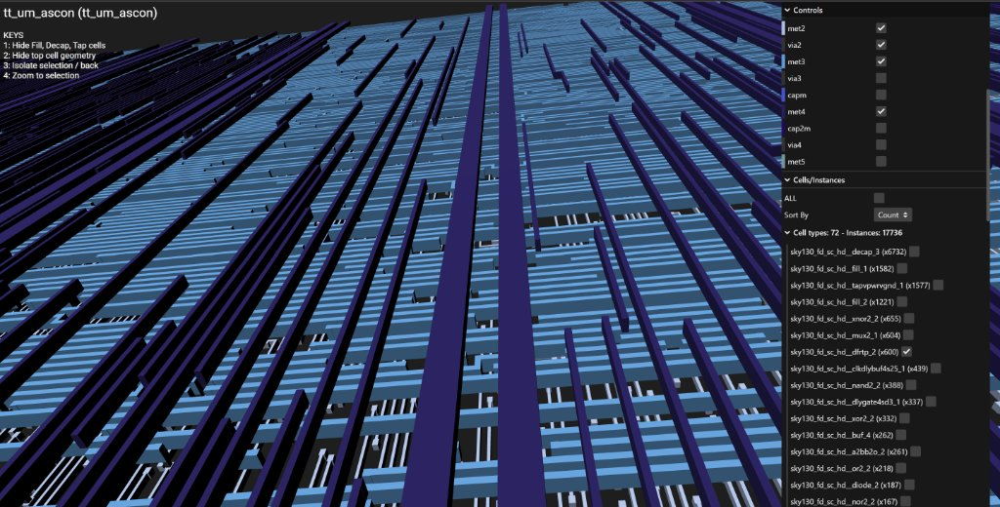
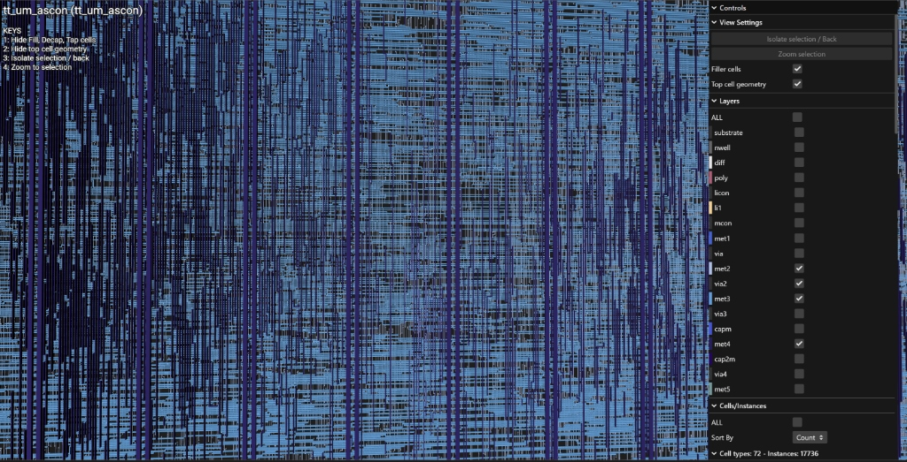
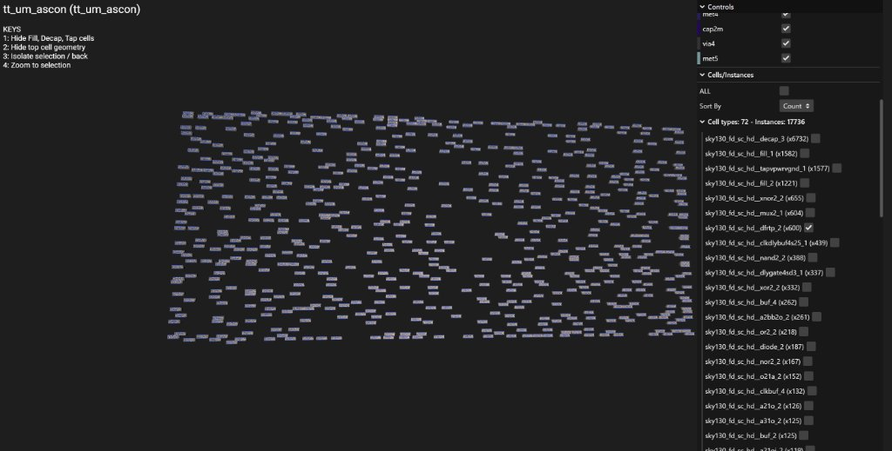
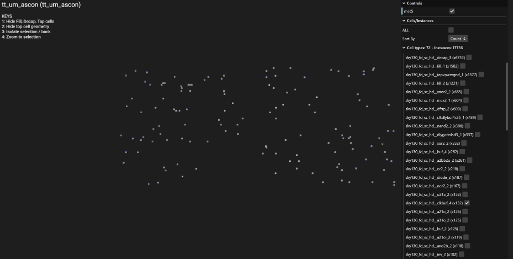
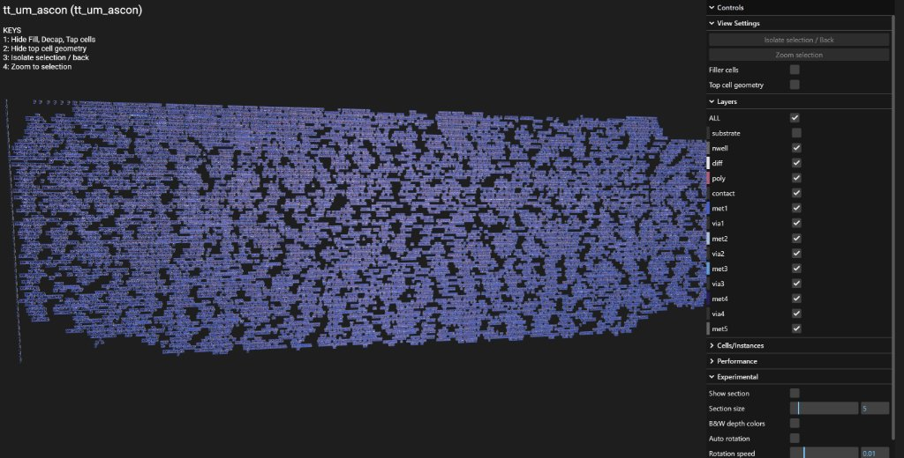
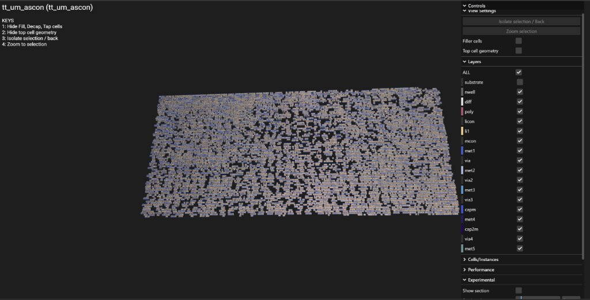

# ASCON-128 ASIC Implementation: Architectural Options & Area Analysis

## 1. Project Overview
* **Algorithm Target**: NIST SP 800-232 (*Ascon-AEAD128*)
* **Key / Nonce / Tag**: 128 bits each
* **Data Block Rate**: 128 bits (words S0, S1)
* **Permutation Rounds**: 12 rounds for Initialization/Finalization, 8 rounds for Data Processing
* **Target Platforms**:
  1. **Tiny Tapeout**: Silicon fabrication on both **SkyWater 130nm** (`sky130_fd_sc_hd` at 50 MHz) and **GlobalFoundries 180nm** (`gf180mcu_fd_sc_mcu7t5v0` at 25 MHz).
  2. **Synopsys ASIC Flow**: Synthesis (`dc_shell`), Static Timing Analysis (`pt_shell`), and Physical Design (`icc2_shell`).

---

## 2. Area Basics: Gate Equivalents (GE) and Tiny Tapeout Tiles

### What is a Gate Equivalent (GE)?
* **1 GE** is defined as the silicon area of a basic **2-input NAND gate** (`NAND2_X1`).
* In the **SkyWater 130nm** library:
  * 1 NAND2 gate = **3.75 square micrometers (um^2)**.
  * Therefore: **1 GE = 3.75 um^2**.

### Cell Sizes in SkyWater 130nm:
* **NAND2 gate**: 3.75 um^2 = **1.0 GE**
* **Inverter (NOT)**: 2.50 um^2 = **0.67 GE**
* **AND2 gate**: 4.50 um^2 = **1.2 GE**
* **XOR2 gate**: 5.60 um^2 = **1.5 GE**
* **2-to-1 Multiplexer**: 5.60 um^2 = **1.5 GE**
* **D Flip-Flop with Reset (DFF)**: 15.00 um^2 = **4.0 to 4.5 GE**

*(Note: 1 bit of flip-flop storage takes as much silicon area as 4 to 5 logic gates!)*

### Tiny Tapeout Tile Limits:
* **1x1 Tile Box**: 160 um x 100 um = **16,000 um^2**.
* **Usable Cell Area (50% density limit)**: 
  * Only ~50% of the area can contain standard cells; the other 50% is required for metal wiring routes and the power grid.
  * Usable area = 16,000 um^2 * 50% = **8,000 um^2**.
  * **1x1 Tile Capacity**: **~2,000 to 2,100 GE** (~1,000 to 1,200 cells).
* **1x2 Tile Capacity**: **~4,000 to 4,200 GE** (~2,400 cells).
* **2x2 Tile Capacity**: **~8,000 to 8,500 GE** (~4,800 cells).

---

## 3. Existing Implementations Analyzed

All reference codebases are organized in the [**`reference_code/`**](file:///c:/Users/shlom/Documents/University/ascon/reference_code) folder:

1. **Robert Primas (`ascon-verilog-rprimas`)** (Graz University of Technology):
   * Official hardware reference for NIST SP 800-232.
   * Parameterizable bus widths (32/64-bit) and unrolling (1, 2, 4 rounds).
   * Fully autonomous AEAD engine with standard `valid`/`ready` handshaking.

2. **Secworks (`ascon-verilog-secworks`)** (Joachim Strömbergson):
   * Gold-standard industrial Verilog-2001.
   * Clean 32-bit memory-mapped register interface (`ADDR_KEY`, `ADDR_BLOCK`, `ADDR_STATUS`).
   * Explicit 128-bit on-chip Key register holding the secret key throughout the session.

3. **Tristan Itschner (`ascon-verilog-tristanitschner`)**:
   * Highly modular pipelined Verilog with formal verification properties.
   * Includes a dedicated hardware padding module (`ascon_pad.v`) for automatic partial-block padding.

4. **Pranav Ullas (`ascon-tinytapeout-pranavUl`)** (Tiny Tapeout TT07, Project #162):
   * **1x2 Tile (2 tiles)** configuration.
   * Minimalist bit-serial permutation core using 5 recirculating 64-bit shift registers and a single 5-bit S-box.
   * Removed all on-chip buffers and AEAD state machine to minimize area; requires the host to stream 5-bit vertical column slices at 50 MHz.

5. **Dr. Mohamed El-Hadedy (`ascon-tinytapeout-mealycpp-full`)** (Tiny Tapeout SKY26b/GF26b):
   * **4x4 Tiles (16 tiles)** configuration.
   * Giant, high-end cryptographic processor with 3 UART interfaces, TRNG, Hash_DRBG, register files, and FIFOs.

---

## 4. What Our Design Takes from Each Implementation

Our project creates a **balanced, optimal architecture** that borrows the best aspects of each prior design while eliminating their drawbacks:

```
┌────────────────────────────────────────────────────────────────────────────────────────┐
│                        OUR ASCON-128 ASIC FUSION DESIGN                                │
├──────────────────────────┬─────────────────────────────┬───────────────────────────────┤
│    FROM ROBERT PRIMAS    │      FROM PRANAV ULLAS      │         FROM SECWORKS         │
│  • Exact NIST SP 800-232 │  • Single 5-bit S-box       │  • Clean 2-process FSM style  │
│    parameters & IV       │  • Recirculating shift-reg  │  • Dedicated 128-bit on-chip  │
│  • 128-bit rate math     │  • Proven 1x2 tile sizing   │    Key register (`key_reg`)   │
├──────────────────────────┼─────────────────────────────┼───────────────────────────────┤
│   FROM TRISTAN ITSCHNER  │    FROM DR. EL-HADEDY       │         OUR INNOVATION        │
│  • Modular separation of │  • Byte-to-word deserializer│  • Byte-to-Column Shift FSM:  │
│    permutation & AEAD    │  • Practical board testing  │    Accepts regular bytes from │
│  • Clean padding logic   │    via standard serial pins │    Raspberry Pi over 8 pins!  │
└──────────────────────────┴─────────────────────────────┴───────────────────────────────┘
```

1. **From Robert Primas**:
   * We use the exact **NIST SP 800-232 Ascon-AEAD128** specification: 128-bit rate ($r=128$), $a=12$, $b=8$, IV `0x00001000808c0001`, and official round constants.
2. **From Pranav Ullas**:
   * We use the **bit-serial recirculation concept** with **one single 5-bit S-box** (28 GE) to keep the core small enough to fit into **2 tiles (`1x2`)** on Tiny Tapeout, cutting fabrication costs.
3. **From Secworks (Joachim Strömbergson)**:
   * We include a **dedicated 128-bit on-chip Key Register** (128 flip-flops = ~576 GE). The host sends the key once, and the chip holds it. We also borrow Secworks' clean, synchronous FSM coding style.
4. **From Tristan Itschner**:
   * We use clear modular hierarchy separating the core permutation engine from the top-level AEAD state controller.
5. **From Dr. Mohamed El-Hadedy**:
   * We adopt a practical, host-friendly interface that accepts standard bytes, rather than raw 5-bit vertical column slices.

---

## 5. How the Raspberry Pi Interacts with Our Chip

In Pranav Ullas's design, using the chip was extremely difficult because the Raspberry Pi had to bit-slice data into vertical columns and clock them cycle-by-cycle at 50 MHz.

In **Our Design**, the chip includes a **Byte-to-Column Shift FSM**. Here is how the Raspberry Pi operates:

```
Raspberry Pi (Python Script)                  Tiny Tapeout ASIC (Our Design)
────────────────────────────                  ──────────────────────────────
Connects GPIOs to ui_in[7:0]
and control handshake pins.

1. CONFIGURATION PHASE:
   Write Command: CMD_SET_KEY
   Stream 16 Key bytes ───────────────> Latches into on-chip 128-bit Key Register.
   (Done once per session!)

2. INITIALIZATION PHASE:
   Write Command: CMD_INIT
   Stream 16 Nonce bytes ─────────────> Loads Nonce directly into S3/S4 registers.
   ASIC asserts BUSY ─────────────────> Automatically executes 12 rounds (p12),
                                        XORs the Key into the state, and sets READY.

3. ASSOCIATED DATA (Optional):
   Write Command: CMD_AD
   Stream AD bytes ───────────────────> Absorbs AD blocks, runs 8 rounds (p8),
                                        and automatically injects 1-bit domain separator.

4. PLAINTEXT ENCRYPTION:
   Write Command: CMD_ENCRYPT
   Stream Plaintext bytes ────────────> XORs with S0/S1, streams out Ciphertext bytes,
                                        and runs 8 rounds (p8) per block.

5. FINALIZATION:
   Write Command: CMD_FINALIZE ───────> Automatically XORs Key, executes 12 rounds (p12),
                                        XORs Key again, and outputs 16-byte Tag!
   Read 16 Tag bytes <───────────────── Raspberry Pi reads tag to verify message.
```

### What the Raspberry Pi Code Looks Like:
```python
# Simple Python snippet running on the Raspberry Pi
from ascon_chip import AsconASIC

chip = AsconASIC(data_pins=..., clk_pin=..., ready_pin=...)

# 1. Load Key once
chip.set_key(b"0123456789abcdef")

# 2. Encrypt packet
nonce = b"unique_nonce_123"
ad = b"header_data"
plaintext = b"Secret sensor reading!"

ciphertext, tag = chip.encrypt(nonce, ad, plaintext)
print("Ciphertext:", ciphertext.hex())
print("Tag:       ", tag.hex())
```

---

## 6. Comprehensive Comparison Table

| Feature | Our Proposed Design | Pranav Ullas (`pranavUl`) | Dr. El-Hadedy (`mealycpp`) | Secworks (`secworks`) | Robert Primas (`rprimas`) |
| :--- | :--- | :--- | :--- | :--- | :--- |
| **Algorithm Standard** | **NIST SP 800-232** | NIST SP 800-232 | NIST SP 800-232 | CAESAR / LWC v1.2 | **NIST SP 800-232** |
| **Tiny Tapeout Tiles** | **1x2 Tile (2 tiles)** | 1x2 Tile (2 tiles) | 4x4 Tiles (16 tiles) | Needs ~2x2 / 3x2 | Needs ~2x2 / 3x2 |
| **Estimated Gate Count**| **~2,600 to 2,800 GE**| ~2,200 GE | > 20,000 GE | ~7,000 GE | ~6,500 GE |
| **Number of S-Boxes** | **1 single 5-bit S-box** | 1 single 5-bit S-box | 64 parallel S-boxes | 64 parallel S-boxes | 64 parallel S-boxes |
| **On-Chip Key Register**| **YES (128-bit DFFs)** | NO (host re-streams) | YES (register file) | YES (128-bit DFFs) | YES (128-bit DFFs) |
| **AEAD Controller** | **YES (Autonomous FSM)**| NO (host does steps) | YES (Multi-mode FSM)| YES (Full FSM) | YES (Full FSM) |
| **Host Interface** | **Standard 8-bit Bytes**| 5-bit vertical slices| 3 UART lines | 32-bit Memory bus | 32/64-bit Handshake |
| **Raspberry Pi Burden** | **Very Low** (sends bytes)| Extremely High | Low (UART) | Low (Needs bus bridge)| Low (Needs bus bridge)|
| **University Cost** | **Minimal ($)** | Minimal ($) | Very High ($$$$) | Medium ($$) | Medium ($$) |

---

## 7. Project Architecture Decision Summary

1. **For Tiny Tapeout Fabrication**:
   * We will build the **1x2 Tile Serial Architecture with On-Chip Key Storage and Byte-to-Column FSM**.
   * It is verified to fit within university cost constraints while remaining fully functional and easy to demo with a Raspberry Pi.

2. **For the Graduation Report & Synopsys ASIC Flow**:
   * We can compare our **1x2 Serial Core** against the **Round-Based Core (Robert Primas / Secworks)** in Synopsys Design Compiler:
     * Showing the 1x2 design as the **Area-Optimized IoT Device**.
     * Showing the round-based design as the **High-Throughput Server Accelerator**.

---

## 8. Detailed Hardware Implementation & Register Map (`tt_um_ascon`)

This section documents the exact pinout, register mapping, and step-by-step loading protocol implemented in [`code/rtl/tt_um_ascon.v`](code/rtl/tt_um_ascon.v) and [`code/rtl/ascon_encryption.v`](code/rtl/ascon_encryption.v).

### 8.1 Pinout Mapping (3-PMOD / Tiny Tapeout Socket)

| Port | PMOD | Direction | Signal | Function |
| :--- | :---: | :---: | :--- | :--- |
| **`ui_in[7:0]`** | PMOD 1 | Input | `wdata[7:0]` | 8-bit Write Data from host |
| **`uo_out[7:0]`** | PMOD 2 | Output | `rdata[7:0]` | 8-bit Read Data to host |
| **`uio_in[5:0]`** | PMOD 3 | Input | `addr[5:0]` | 6-bit Byte Address (`0x00` – `0x3F`) |
| **`uio_in[6]`** | PMOD 3 | Input | `wr_en` | Active-high Write Strobe (detected via 2-stage synchronizer) |
| **`uio_in[7]`** | PMOD 3 | Input | `rd_en` | Active-high Read Enable (gates `uo_out`) |
| **`clk`** | — | Input | `clk` | System clock (up to 50 MHz) |
| **`rst_n`** | — | Input | `rst_n` | Global asynchronous reset (active-low) |
| **`ena`** | — | Input | `ena` | Tile enable (tied high / ignored) |

*Note: Bidirectional pins `uio_oe` and `uio_out` are permanently tied to `8'b00000000` (safe input mode).*

---

### 8.2 Address Map

| Address Range | Size | Write (`wr_en = 1`) | Read (`rd_en = 1`) |
| :---: | :---: | :--- | :--- |
| **`0x00 – 0x0F`** | 16 Bytes | **`io_buf[0..15]`**<br>Write Nonce, Key, AD, or Plaintext | **`io_buf[0..15]`**<br>Read Ciphertext (or verify written data) |
| **`0x10 – 0x1F`** | 16 Bytes | *(Unused)* | **`TAG[0..15]`**<br>Read 16-byte Tag directly from core wires |
| **`0x20`** | 1 Byte | **Control Register** | **Guided Status Register** |

*Byte Ordering: Byte 0 (Address `0x00` / `0x10`) is the **MSB** (`[127:120]`), and Byte 15 (Address `0x0F` / `0x1F`) is the **LSB** (`[7:0]`).*

---

### 8.3 Control & Status Register Bitfields (`0x20`)

#### Control Register (`0x20`, Write):
* **`bit 0` — `load` (Pulse)**: Pulse `1` to commit `io_buf` into the core (auto-clears).
* **`bit 1` — `ad_empty` (Pulse)**: Pulse `1` while in `ready_for_ad` to bypass the Associated Data phase when there is no AD.
* **`bit 2` — `last` (Level)**: `1` = This is the final block of AD or Plaintext; `0` = More blocks follow.
* **`bits 6:3` — `data_length[3:0]` (Level)**: Partial block length (0 to 15 bytes) for the final padded block.
* **`bit 7`**: Reserved (set to `0`).

#### Guided Status Register (`0x20`, Read):
* **`bit 0` — `ready_for_nonce`**: High when core is waiting for the 16-byte Nonce (`fsm == I_NONCE`).
* **`bit 1` — `ready_for_key`**: High when core is waiting for the 16-byte Key (`fsm == I_KEY`).
* **`bit 2` — `ready_for_ad`**: High when core is waiting for an Associated Data block or `ad_empty` (`fsm == AD_LOAD`).
* **`bit 3` — `ready_for_pt`**: High when core is waiting for a Plaintext block (`fsm == PT_LOAD`).
* **`bit 4` — `ct_ready` (Sticky)**: Set to `1` when Ciphertext is ready in `io_buf`. Automatically cleared when loading a new PT block.
* **`bit 5` — `finish` (Sticky)**: Set to `1` when encryption is complete and Tag is ready in `0x10–0x1F`. Cleared on next packet.
* **`bits 7:6`**: Unused (tied to `2'b00`).

---

### 8.4 Operating Sequence & Handshake Protocol

To encrypt a message, the host follows this strict sequential order:

```
                  ┌───────────────────────────────┐
                  │ Poll Status (0x20) for bit 0  │
                  │     (ready_for_nonce == 1)    │
                  └──────────────┬────────────────┘
                                 │
                 1. Write 16B Nonce to 0x00-0x0F
                 2. Write 0x01 to 0x20 (load = 1)
                                 │
                  ┌──────────────▼────────────────┐
                  │ Poll Status (0x20) for bit 1  │
                  │      (ready_for_key == 1)     │
                  └──────────────┬────────────────┘
                                 │
                 1. Write 16B Key to 0x00-0x0F
                 2. Write 0x01 to 0x20 (load = 1)
                    -> Core runs 12 init rounds!
                                 │
                  ┌──────────────▼────────────────┐
                  │ Poll Status (0x20) for bit 2  │
                  │       (ready_for_ad == 1)     │
                  └──────────────┬────────────────┘
                                 │
         ┌───────────────────────┴───────────────────────┐
         │                                               │
  [If AD Present]                                   [If NO AD]
1. Write 16B AD to 0x00-0x0F                    Write 0x02 to 0x20
2. Write to 0x20 with:                          (ad_empty = 1)
   load=1, last, data_length                            │
         │                                               │
         └───────────────────────┬───────────────────────┘
                                 │
                  ┌──────────────▼────────────────┐
                  │ Poll Status (0x20) for bit 3  │
                  │       (ready_for_pt == 1)     │
                  └──────────────┬────────────────┘
                                 │
                 1. Write 16B Plaintext to 0x00-0x0F
                 2. Write to 0x20 with:
                    load=1, last, data_length
                 3. Read 16B Ciphertext from 0x00-0x0F
                    when bit 4 (ct_ready) == 1
                                 │
                  ┌──────────────▼────────────────┐
                  │ Poll Status (0x20) for bit 5  │
                  │          (finish == 1)        │
                  └──────────────┬────────────────┘
                                 │
                 Read 16B Tag from 0x10-0x1F!
```

1. **Supply Nonce (First):**
   * Wait until Status `bit 0` (`ready_for_nonce`) is `1`.
   * Write the 16 bytes of Nonce into `0x00–0x0F`.
   * Pulse `load`: Write `8'h01` to `0x20`. The core transitions to `I_KEY`.
2. **Supply Key (Second):**
   * Wait until Status `bit 1` (`ready_for_key`) is `1`.
   * Write the 16 bytes of Key into `0x00–0x0F`.
   * Pulse `load`: Write `8'h01` to `0x20`. The core saves the key into `k`, places it in the state, and runs the 12-round initialization permutation (`I_PERMUTATE`), adds the key (`I_FINISH`), and transitions to `AD_LOAD`.
3. **Supply Associated Data (or Skip):**
   * Wait until Status `bit 2` (`ready_for_ad`) is `1`.
   * *If AD is present*: Write 16 bytes to `0x00–0x0F`, write `{1'b0, data_length, last, 1'b0, 1'b1}` to `0x20`. If `last == 0`, wait for `ready_for_ad` again for the next AD block.
   * *If NO AD*: Write `8'h02` to `0x20` (`ad_empty = 1`). The core skips the AD permutation and transitions directly to `PT_LOAD`.
4. **Supply Plaintext & Read Ciphertext:**
   * Wait until Status `bit 3` (`ready_for_pt`) is `1`.
   * Write 16 bytes of Plaintext into `0x00–0x0F`.
   * Write `{1'b0, data_length, last, 1'b0, 1'b1}` to `0x20`.
   * Read the 16 bytes of Ciphertext from `0x00–0x0F` (valid when `bit 4` `ct_ready` is `1`).
5. **Read Authentication Tag:**
   * Wait until Status `bit 5` (`finish`) is `1`.
   * Read the final 16-byte Tag directly from `0x10–0x1F`.
   * The core automatically returns to `I_NONCE` (`ready_for_nonce == 1`) for the next message.

---

### 8.5 Simulation & Verification

The design is fully verified against the NIST SP 800-232 test vector in ModelSim:

```bash
vlog code/rtl/ascon_round.v code/rtl/ascon_encryption.v code/rtl/tt_um_ascon.v code/tb/tb_tt_um_ascon.v
vsim -c -do "run -all; quit" tb_tt_um_ascon
```

---

## 9. Cross-PDK Physical Implementation & Timing Closure (`sky130A` vs. `gf180mcuD`)

### 9.1 GlobalFoundries 180nm (`gf180mcuD`) Timing Closure & Interconnect Constraints
* **Clean Physical Routing in `3x2` Tiles**: In `gf180mcuD`, the physical implementation routes cleanly within the `3x2` tile budget (`PL_TARGET_DENSITY_PCT = 60%`) with **0 DRC violations** and passes LVS and gate-level verification.
* **3-Layer Interconnect Detouring (`Metal2–Metal4`)**: Because `Metal1` is consumed internally by the 7-track standard cells (`0` global routing tracks), only **3 metal routing layers (`Metal2–Metal4`)** are available for signal routing (`Metal5` is reserved for the top-level Tiny Tapeout harness). Consequently, the high-fanout 64-bit circular rotation nets ($p_L$) must detour around congestion across just 3 routing layers and a $2\times$ wider tile footprint ($\approx 1020 \times 320\ \mu\text{m}$).
* **Critical Path & Setup Timing Closure**: This interconnect $RC$ delay, compounded by 180nm (3.3V/5.0V) gate propagation delays through the single-cycle unrolled round logic (64 parallel 5-bit S-boxes + diffusion XOR trees + multiplexers), results in a critical path delay of $\approx 25\text{ ns}$ (further exacerbated at `20 ns` by timing-resizer buffer insertion).
* **50 MHz (`sky130A`) vs. 25 MHz (`gf180mcuD`)**: While the faster 130nm (1.8V) node with 4 signal routing layers (`li1` + `met1–met4` in `sky130A`) easily closes timing at **50 MHz (`20 ns`)**, relaxing the `gf180mcuD` clock constraint to **25 MHz (`40 ns`)** eliminates resizer buffer bloat and closes timing cleanly across all corners with **zero setup violations**.

### 9.2 SkyWater 130nm (`sky130A`) Physical Optimization & Density Tuning
On the **SkyWater 130nm (`sky130_fd_sc_hd`)** open-source PDK, our parallel round-based architecture closes timing at the full **50 MHz (`20 ns`)** target clock:
* **Expanded Routing Stack (`li1` + `met1`–`met4`)**: SkyWater 130nm provides a local interconnect layer (`li1`) for internal cell connections plus 4 signal metal layers (`met1`, `met2`, `met3`, `met4`) inside the Tiny Tapeout macro (`RT_MAX_LAYER: "met4"`). This extra routing layer and smaller tile footprint ($\approx 500 \times 216\ \mu\text{m}$) reduce both routing congestion and interconnect $RC$ parasitics.
* **Tile Sizing & Placement Density Tuning**:
  * **Initial Pass (`4x2` tiles, `PL_TARGET_DENSITY_PCT = 50%`)**: Achieved a clean, zero-DRC build at `48.26%` utilization (`442.6 mm` total wire length).
  * **Area Shrink (`3x2` tiles, `PL_TARGET_DENSITY_PCT = 70%`)**: Packing the cells at 70% density in a `3x2` footprint caused the router to stall on a single stubborn `met1` spacing violation.
  * **Final Optimal Fit (`3x2` tiles, `PL_TARGET_DENSITY_PCT = 60%`)**: Relaxing the target placement density to **60%** allowed the global placer to spread out local pin clusters just enough for the router to converge cleanly with **0 DRC violations**, **`65.01%` final utilization**, and a **15.4% reduction in total wire length (`374.4 mm`)** compared to the `4x2` layout.

---

## 10. Physical Silicon & GDSII Microarchitecture Analysis

This section documents the physical layout structure of the manufactured ASIC, verified through the Tiny Tapeout 3D GDS Viewer across both `sky130A` and `gf180mcuD` runs.

### 10.1 Front-End of Line (FEOL): Transistors & Standard Cells

In CMOS planar manufacturing, standard cells are organized into horizontal cell rows with alternating polarity to allow adjacent rows to share power (`VDD`) and ground (`VSS`) rails.

| Concept | Visual Reference | Physical Explanation |
| :--- | :---: | :--- |
| **Cell Rows & CMOS Tub Slices** |  | • **`nwell` (Light Gray)**: N-type tubs implanted in the wafer to house **PMOS** pull-up transistors.<br>• **`substrate` (Dark Gray)**: Native P-type wafer housing **NMOS** pull-down transistors.<br>• Alternating horizontal stripes save silicon area by flipping every second row. |
| **Single MOSFET Transistor** |  | • **Gate (`poly`)**: Vertical pink polysilicon bar ($L \approx 180\text{ nm}$ in GF180) forming an electric field channel.<br>• **Source & Drain (`diff`)**: Active diffusion regions (white) flanking the gate.<br>• End-cap poly extensions prevent source-drain leakage around diffusion edges. |
| **Multi-Finger Shared Diffusion (`NAND2`)** |  | • Standard cells use **one continuous diffusion slab** crossed by multiple poly gates.<br>• **Top (N-Well)**: 2 parallel PMOS transistors share a central Drain connected to the output, flanked by two Sources connected to `VDD`.<br>• **Bottom (Substrate)**: 2 series NMOS transistors share an uncontacted central diffusion node (Drain of A = Source of B), eliminating internal metal wiring. |

### 10.2 Back-End of Line (BEOL): Interconnect & Power Grid (PDN)

The metal stack uses a strict Manhattan routing grid (alternating preferred directions per layer) to route high-fanout cryptographic permutation signals without wire collision:

| Physical Layer | Preferred Direction | Visual Reference | Function in ASCON Core |
| :--- | :---: | :---: | :--- |
| **`met4`** | **Vertical** |  | **Power Grid & Clock Trunks**: Thick vertical purple beams spaced at `"FP_PDN_VPITCH": 38.87` $\mu\text{m}$ to distribute `VPWR` and `VGND` with minimal IR-drop, plus main vertical clock trunks. |
| **`met3`** | **Horizontal** |  | **Long Datapath Highways**: Carries the wide 320-bit Ascon state ($S_0..S_4$) across circular rotation XOR trees (`p_L`) and the 128-bit bus between I/O pads and core registers. |
| **`met2`** | **Vertical** | *(Deep vertical tracks)* | **Cell Pin Drops**: Connects horizontal `met3` highways through `via2` plugs down to the specific input/output pins of individual logic gates and flip-flops. |

### 10.3 Placement Architecture & Clock Tree Synthesis (CTS)

| Architectural Feature | Layout Snapshot | Physical Design Reasoning |
| :--- | :---: | :--- |
| **Distributed Flip-Flop Placement** |  | • The **600 D flip-flops (`dfxtp_2`)** are distributed uniformly across all rows rather than grouped into a central bank.<br>• **Why?** Spreading the registers interleaves them directly with their corresponding combinational S-box and diffusion logic, minimizing wire propagation delay ($RC$) and preventing local switching power surges (IR-drop droop). |
| **Clock Tree Repeaters (CTS)** |  | • **132 leaf clock buffers (`clkbuf_4`)** are placed in a balanced grid.<br>• Each buffer drives a localized cluster of **4 to 5 flip-flops** ($600 \div 132 \approx 4.5$), regenerating sharp digital clock edges and minimizing clock skew across the entire tile. |
| **Cross-PDK Die Utilization** | <br>*(Above: GF180 180nm)*<br><br><br>*(Above: Sky130 130nm)* | • **SkyWater 130nm (`3x2` tiles, $500 \times 216\ \mu\text{m}$)**: Achieves **65.01% cell utilization** at 50 MHz.<br>• **GlobalFoundries 180nm (`3x2` tiles, $1020 \times 320\ \mu\text{m}$)**: Wider footprint allows cells to cluster near the active I/O port edge, closing timing cleanly at 25 MHz with 0 DRC violations. |

---

## 11. Hardware Compilation & FPGA Implementation: From Verilog RTL to Physical Silicon

This section documents the theoretical and physical mechanics of compiling synthesizable Verilog code into hardware, verified on the **AMD Artix-7 FPGA (Digilent Basys 3, `xc7a35tcpg236-1`)** and contrasted with standard cell ASIC flows.

### 11.1 What is RTL vs. HDL?
* **HDL (Hardware Description Language):** The text language used to describe hardware (Verilog IEEE 1364, SystemVerilog IEEE 1800, VHDL).
* **RTL (Register-Transfer Level):** The abstraction style of hardware design:
  1. **Registers (Flip-Flops):** Synchronous storage elements capturing state on clock edges.
  2. **Transfer Logic:** Combinational Boolean networks (math, multiplexers, XOR trees) transferring evaluated data between registers on the subsequent clock tick.
* **Why the folder is named `rtl/`:** An industry-wide convention (Apple, NVIDIA, Synopsys) distinguishing synthesizable synchronous digital logic from non-synthesizable behavioral testbenches.

### 11.2 The Hardware Compilation Pipeline

```
[ Verilog RTL (.v) ] ──► [ 1. Elaboration ] ──► [ 2. Synthesis ] ──► [ 3. Place & Route ] ──► [ Bitstream / GDS ]
  (Human source)        (Generic boxes)        (Target Netlist)     (Physical Layout)         (Silicon/Flash)
```

1. **RTL Elaboration (Generic Analysis):**
   * The compiler parses the human-written Verilog text and builds an abstract, technology-independent schematic in memory (`RAM`) using generic symbols: `RTL_REG`, `RTL_ADD`, `RTL_MUX`, `RTL_INV`, `RTL_BMERGE`.
   * No target-specific cells or gate-level netlists exist at this stage.
2. **Synthesis & Technology Mapping (Where the Netlist is Born):**
   * Translates abstract Boolean operators into the physical target library:
     * **FPGA:** Mapped to **LUTs (Look-Up Tables)**, **FDCE flip-flops**, and **CARRY4** fast-carry chains from the Xilinx `UNISIM` library.
     * **ASIC:** Mapped to **Standard Cells** (`sky130_fd_sc_hd__nand2`, `gf180mcu_fd_sc_mcu7t5v0__nand2`) from foundry `.lib` catalogs.
   * Produces the structural **Gate-Level Netlist**.
3. **Implementation (Place & Route):**
   * **Placement:** Assigns each cell to exact physical $(X, Y)$ coordinates on the silicon die (e.g., `Row: 133, Column: 71`).
   * **Routing:** Routes physical metal tracks (copper/aluminum) through routing channels and switch matrices, closing setup and hold timing.

### 11.3 RTL Portability vs. The Netlist One-Way Street
* **RTL is Universal:** A single golden Verilog RTL file (`tt_um_ascon.v`) compiles across any FPGA or ASIC tool worldwide without modification.
* **The Netlist is Technology-Locked:** An Artix-7 FPGA netlist (`LUT6`, `FDCE`) cannot be fabricated on an ASIC, nor can an ASIC netlist run on an FPGA without re-mapping.
* **The One-Way Street:** Translating RTL to a Netlist is fast and automated (Synthesis). Translating a Netlist back to clean, human-readable RTL with state machines, variable names, and comments is virtually impossible (analogous to decompiling assembly into C).

### 11.4 FPGA vs. ASIC Architecture Comparison

| Architectural Feature | FPGA (Basys 3 / Artix-7) | ASIC (Tiny Tapeout: Sky130 / GF180) |
| :--- | :--- | :--- |
| **Silicon State** | **Pre-manufactured** at TSMC. Pre-fabricated LUTs and wires. | **Blank wafer**. All transistors and metal layers etched from scratch. |
| **Logic Primitive** | **LUT (Look-Up Table)** | **Standard Cell** (`NAND2`, `NOR2`, `INV`, `AOI21`) |
| **Library Description** | Xilinx **UNISIM** (`LUT6`, `FDCE`, `CARRY4`, `BUFG`, `IBUF`) | Foundry **Liberty (`.lib`)** & LEF (`.lef`) files |
| **Logic Implementation** | 64-bit truth tables stored in tiny SRAM memories. | Physical P-channel and N-channel CMOS transistors. |
| **Reconfigurability** | **Instant & Free:** Re-flash SRAM bitstream over USB. | **Permanent:** Hardened silicon masks at the foundry. |

### 11.5 Physical Anatomy of an FPGA Slice & How LUTs Work
An FPGA contains **no physical discrete AND/OR gates**. All combinational logic is evaluated using **LUTs (Look-Up Tables)**:

* **SRAM Cell Physics (6T SRAM):** Each memory bit inside a LUT consists of two cross-coupled CMOS inverters (4 transistors) forming a bistable latch holding `0` or `1`, accessed via two NMOS pass transistors.
* **The `LUT6` Architecture:**
  * Contains **64 SRAM bits** storing a pre-computed truth table (the `INIT` parameter).
  * A **6-level binary multiplexer tree (64-to-1 MUX)** controlled by inputs $I_0..I_5$.
  * Any Boolean function of $\le 6$ inputs evaluates in **constant propagation delay ($\approx 0.15\text{ ns}$)**, regardless of Boolean complexity.
* **Artix-7 Slice Layout (Visible in Vivado Device View):**
  * **Configurable Logic Block (CLB):** Comprises 2 Slices (`SLICEL` for pure logic, `SLICEM` supporting distributed RAM).
  * **Per Slice Resources:**
    1. **4 $\times$ `LUT6` (`A6LUT`, `B6LUT`, `C6LUT`, `D6LUT`)**: Combinational truth-tables.
    2. **1 $\times$ `CARRY4` (Dedicated BEL)**: Hard-wired fast-carry adder/subtractor chain bypassing LUT routing delay.
    3. **8 $\times$ Flip-Flops (`AFF`..`DFF`, `AFF2`..`DFF2`)**: Physical storage capturing state on clock edges.

### 11.6 Basys 3 Physical Implementation Findings (`xc7a35tcpg236-1`)
* **Total Resource Footprint:** The entire Ascon-128 core, top-level wrapper, clock divider, and I/O logic synthesizes into only **439 Cells, 42 I/O Ports, and 750 Nets** (<2% of total Artix-7 capacity).
* **Wire Shift Optimization ($\times 8$):** The buffer addressing expression `127 - byte_addr*8` compiles with **0 logic gates and 0 LUTs**. In binary, multiplying by 8 is an arithmetic left-shift by 3 ($\ll 3$), implemented strictly as physical copper wire reordering with the 3 lowest bits tied to ground (`GND`).
* **Onboard Clock Division (100 MHz $\rightarrow$ 12.5 MHz):** To prevent signal reflections, ground bounce, and crosstalk over loose PMOD jumper wires connecting to the Raspberry Pi, a 3-bit synchronous counter (`clk_div[2:0]`) divides the Basys 3 onboard 100 MHz oscillator down to a rock-solid **12.5 MHz** test clock (`tt_clk = clk_div[2]`).
* **I/O & Clock Buffering:**
  * **`IBUF`:** Levels external 3.3V LVCMOS PMOD inputs safely down to internal 1.0V core transistor logic.
  * **`BUFG`:** Drives the 12.5 MHz clock onto low-skew silicon clock spine trunks, ensuring all 320 state flip-flops receive clock edges with sub-picosecond skew.
* **Physical Placement:** Routed densely within Clock Region `X1Y0` (Tile `CLBLL_L_X28Y22`, Row 133, Column 71), minimizing interconnect $RC$ parasitic delays.


