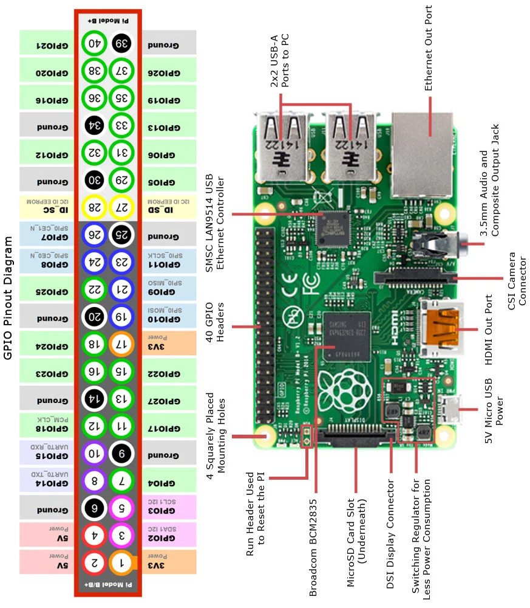

# Raspberry Pi & Basys 3 Hardware-in-the-Loop Setup Guide

This guide details how to wire and test your **Ascon-128 AEAD Hardware Accelerator** implemented on the **Digilent Basys 3 FPGA** using a **Raspberry Pi** as the automated master test controller.

---

## 1. Safety & Voltage Compatibility

> [!IMPORTANT]
> **Logic Level Compatibility**:
> * **Raspberry Pi GPIOs**: 3.3V LVCMOS
> * **Digilent Basys 3 PMODs**: 3.3V LVCMOS (`IOSTANDARD LVCMOS33`)
> * **Result**: 100% directly compatible! **No level-shifter chips are required.**
>
> **CRITICAL RULE: COMMON GROUND**
> You **MUST** connect at least one Ground pin from the Raspberry Pi (e.g., Pin 6 or 14) to the Basys 3 PMOD Ground (Pin 5 or 11 on any PMOD header). Without a common electrical ground, signal readings will float and corrupt data!

---

## 2. Complete Wiring Table ("Parallel Rails" Layout: JB -> JC -> JA)

### Visual Board Orientation:
Orient your Raspberry Pi with the **USB / Ethernet ports facing UP** (away from you) and the **MicroSD slot facing DOWN** (towards you):
The 40-pin header is located along the **LEFT edge** of the board:
* **OUTER RAIL (Left Column &mdash; Even Pins 2..40)**: Along the outer left edge of the PCB.
* **INNER RAIL (Right Column &mdash; Odd Pins 1..39)**: Running along the inside, closer to the metal CPU / SoC.

> [!WARNING]
> **Basys 3 Port Placement**:
> * **Left Side**: Top = **PMOD JA** (Write Bus), Bottom = **PMOD JB** (Read Bus)
> * **Right Side**: Top = **PMOD JC** (Address & Control Strobe), Bottom = **JXADC** (Analog &mdash; **LEAVE EMPTY**)
> * **Never connect PMOD Pin 6 or Pin 12 (3.3V power)** &mdash; only connect Pins 1-4, 5 (GND), and 7-10.
> * **RPi Pin 40 is a signal pin (GPIO 21 / rdata[0])** &mdash; do **NOT** connect it to Ground!

> [!NOTE]
> **Universal PMOD Pin-to-Color Scheme**:
> **All PMOD headers (JA, JB, and JC) follow the exact same pin-to-color mapping for all connections:**
> * **Top Row**: Pin 1 = <span style="color: #000; background-color: #e0e0e0; padding: 1px 4px; border-radius: 3px; font-weight: bold;">Black</span>, Pin 2 = <span style="color: #fff; background-color: #424242; padding: 1px 4px; border-radius: 3px; font-weight: bold;">White</span>, Pin 3 = <span style="color: #9e9e9e; font-weight: bold;">Gray</span>, Pin 4 = <span style="color: #ba68c8; font-weight: bold;">Purple</span>, Pin 5 = <span style="color: #29b6f6; font-weight: bold;">Blue (GND)</span>
> * **Bottom Row**: Pin 7 = <span style="color: #bcaaa4; font-weight: bold;">Brown</span>, Pin 8 = <span style="color: #ef5350; font-weight: bold;">Red</span>, Pin 9 = <span style="color: #ffa726; font-weight: bold;">Orange</span>, Pin 10 = <span style="color: #fbc02d; font-weight: bold;">Yellow</span>

<pre style="font-family: Consolas, 'Courier New', monospace; line-height: 1.45;">
                      ▲ TOP: USB / ETHERNET PORTS (Pins 39 & 40) ▲

          OUTER RAIL (Left Column)               INNER RAIL (Right Column)
         [Along Outer Board Edge]                  [Toward Metal CPU / SoC]
     (5-wire bundles + GND references)               (4-wire signal bundles)
   =====================================       ===================================
   <span style="color: #000; background-color: #e0e0e0; padding: 1px 3px; border-radius: 3px;">JB Top rdata[0] - [Pin 40] GPIO21</span>   |  GND   [Pin 39]
   <span style="color: #fff; background-color: #424242; padding: 1px 3px; border-radius: 3px;">JB Top rdata[1] - [Pin 38] GPIO20</span>   | GPIO26 [Pin 37]
   <span style="color: #9e9e9e;">JB Top rdata[2] - [Pin 36] GPIO16</span>   | GPIO19 [Pin 35] - <span style="color: #bcaaa4;">JB Bottom rdata[4]</span>   PMOD JB ZONE
   <span style="color: #29b6f6;">JB Top GND      - [Pin 34]  GND   </span>  | GPIO13 [Pin 33] - <span style="color: #ef5350;">JB Bottom rdata[5]</span>   (Read Bus: uo_out)
   <span style="color: #ba68c8;">JB Top rdata[3] - [Pin 32] GPIO12</span>   | GPIO6  [Pin 31] - <span style="color: #ffa726;">JB Bottom rdata[6]</span>   (Top Zone)
                     [Pin 30]  GND     | GPIO5  [Pin 29] - <span style="color: #fbc02d;">JB Bottom rdata[7]</span>
   -----------------------------------------------------------------------------------------
                     [Pin 28] ID_SC    | ID_SD  [Pin 27]  (Reserved - Empty)
   <span style="color: #000; background-color: #e0e0e0; padding: 1px 3px; border-radius: 3px;">JC Top addr[0]  - [Pin 26] GPIO7 </span>   |  GND   [Pin 25]
   <span style="color: #fff; background-color: #424242; padding: 1px 3px; border-radius: 3px;">JC Top addr[1]  - [Pin 24] GPIO8 </span>   | GPIO11 [Pin 23]
   <span style="color: #9e9e9e;">JC Top addr[2]  - [Pin 22] GPIO25</span>   | GPIO9  [Pin 21] - <span style="color: #bcaaa4;">JC Bottom bank     </span>   PMOD JC ZONE
   <span style="color: #29b6f6;">JC Top GND      - [Pin 20]  GND   </span>  | GPIO10 [Pin 19] - <span style="color: #ef5350;">JC Bottom read_tag </span>   (Control/Address: uio_in)
   <span style="color: #ba68c8;">JC Top addr[3]  - [Pin 18] GPIO24</span>   |  3.3V  [Pin 17]                        (Middle Zone)
   -----------------------------------------------------------------------------------------
   <span style="color: #000; background-color: #e0e0e0; padding: 1px 3px; border-radius: 3px;">JA Top wdata[0] - [Pin 16] GPIO23</span>   | GPIO22 [Pin 15] - <span style="color: #ffa726;">JC Bottom write_raw</span>
   <span style="color: #29b6f6;">JA Top GND      - [Pin 14]  GND   </span>  | GPIO27 [Pin 13] - <span style="color: #fbc02d;">JC Bottom unused   </span>
   <span style="color: #fff; background-color: #424242; padding: 1px 3px; border-radius: 3px;">JA Top wdata[1] - [Pin 12] GPIO18</span>   | GPIO17 [Pin 11] - <span style="color: #bcaaa4;">JA Bottom wdata[4]</span>   PMOD JA ZONE
   <span style="color: #9e9e9e;">JA Top wdata[2] - [Pin 10] GPIO15</span>   |  GND   [Pin 9]                         (Write Bus: ui_in)
   <span style="color: #ba68c8;">JA Top wdata[3] - [Pin 8]  GPIO14</span>   | GPIO4  [Pin 7]  - <span style="color: #ef5350;">JA Bottom wdata[5]</span>   (Bottom Zone)
                     [Pin 6]   GND     | GPIO3  [Pin 5]  - <span style="color: #ffa726;">JA Bottom wdata[6]</span>
                     [Pin 4]   5V      | GPIO2  [Pin 3]  - <span style="color: #fbc02d;">JA Bottom wdata[7]</span>
                     [Pin 2]   5V      |  3.3V  [Pin 1]

                     ▼ BOTTOM: MicroSD CARD SLOT (Pins 1 & 2) ▼
</pre>

### Visual Pinout References:

---

## 3. Step-by-Step Bundle Wiring

Connect your wires in **6 clean bundles** from Top to Bottom (every PMOD header uses the exact same wire color scheme for its pin connections):

### Bundle 1: PMOD JB Top Row (Read Data Low Bits 0..3)
* RPi **Pin 40** (GPIO 21, Black) $\rightarrow$ Basys 3 **JB1** (`uo_out[0]`)
* RPi **Pin 38** (GPIO 20, White) $\rightarrow$ Basys 3 **JB2** (`uo_out[1]`)
* RPi **Pin 36** (GPIO 16, Gray)  $\rightarrow$ Basys 3 **JB3** (`uo_out[2]`)
* RPi **Pin 34** (GND, Blue)      $\rightarrow$ Basys 3 **JB5** (GND)
* RPi **Pin 32** (GPIO 12, Purple)$\rightarrow$ Basys 3 **JB4** (`uo_out[3]`)

### Bundle 2: PMOD JB Bottom Row (Read Data High Bits 4..7)
* RPi **Pin 35** (GPIO 19, Brown) $\rightarrow$ Basys 3 **JB7** (`uo_out[4]`)
* RPi **Pin 33** (GPIO 13, Red)   $\rightarrow$ Basys 3 **JB8** (`uo_out[5]`)
* RPi **Pin 31** (GPIO 6, Orange) $\rightarrow$ Basys 3 **JB9** (`uo_out[6]`)
* RPi **Pin 29** (GPIO 5, Yellow) $\rightarrow$ Basys 3 **JB10** (`uo_out[7]`)

### Bundle 3: PMOD JC Top Row (Address Bits 0..3)
* RPi **Pin 26** (GPIO 7, Black)  $\rightarrow$ Basys 3 **JC1** (`addr[0]`)
* RPi **Pin 24** (GPIO 8, White)  $\rightarrow$ Basys 3 **JC2** (`addr[1]`)
* RPi **Pin 22** (GPIO 25, Gray)  $\rightarrow$ Basys 3 **JC3** (`addr[2]`)
* RPi **Pin 20** (GND, Blue)      $\rightarrow$ Basys 3 **JC5** (GND)
* RPi **Pin 18** (GPIO 24, Purple)$\rightarrow$ Basys 3 **JC4** (`addr[3]`)

### Bundle 4: PMOD JC Bottom Row (Control & Write Strobe)
* RPi **Pin 21** (GPIO 9, Brown)  $\rightarrow$ Basys 3 **JC7** (`bank` - `uio[4]`)
* RPi **Pin 19** (GPIO 10, Red)   $\rightarrow$ Basys 3 **JC8** (`read_tag` - `uio[5]`)
* RPi **Pin 15** (GPIO 22, Orange)$\rightarrow$ Basys 3 **JC9** (`write_raw` - `uio[6]`)
* RPi **Pin 13** (GPIO 27, Yellow)$\rightarrow$ Basys 3 **JC10** (`unused` - `uio[7]`)

### Bundle 5: PMOD JA Top Row (Write Data Low Bits 0..3)
* RPi **Pin 16** (GPIO 23, Black) $\rightarrow$ Basys 3 **JA1** (`ui_in[0]`)
* RPi **Pin 14** (GND, Blue)      $\rightarrow$ Basys 3 **JA5** (GND)
* RPi **Pin 12** (GPIO 18, White) $\rightarrow$ Basys 3 **JA2** (`ui_in[1]`)
* RPi **Pin 10** (GPIO 15, Gray)  $\rightarrow$ Basys 3 **JA3** (`ui_in[2]`)
* RPi **Pin 8**  (GPIO 14, Purple)$\rightarrow$ Basys 3 **JA4** (`ui_in[3]`)

### Bundle 6: PMOD JA Bottom Row (Write Data High Bits 4..7)
* RPi **Pin 11** (GPIO 17, Brown) $\rightarrow$ Basys 3 **JA7** (`ui_in[4]`)
* RPi **Pin 7**  (GPIO 4, Red)    $\rightarrow$ Basys 3 **JA8** (`ui_in[5]`)
* RPi **Pin 5**  (GPIO 3, Orange) $\rightarrow$ Basys 3 **JA9** (`ui_in[6]`)
* RPi **Pin 3**  (GPIO 2, Yellow) $\rightarrow$ Basys 3 **JA10** (`ui_in[7]`)

---

## 4. Running the Test Suite

```bash
# Run all tests (Basic + Multi-packet)
python3 rpi_test.py

# Run only the basic sanity suite
python3 rpi_test.py --mode basic

# Run in mock simulation mode on a PC (no RPi GPIO required)
python3 rpi_test.py --mock
```
